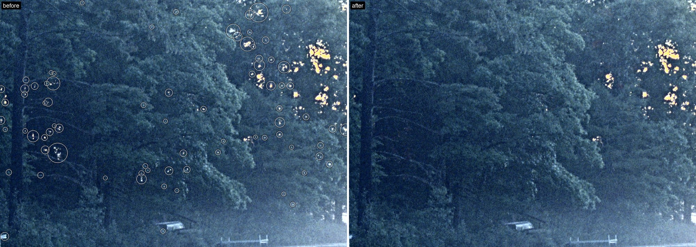
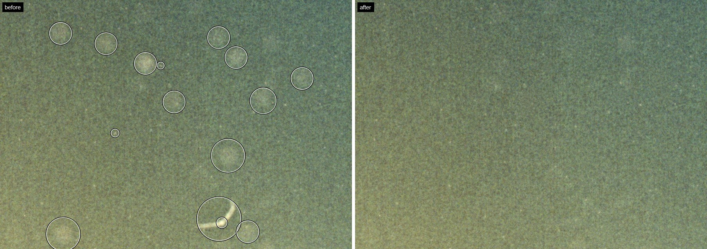
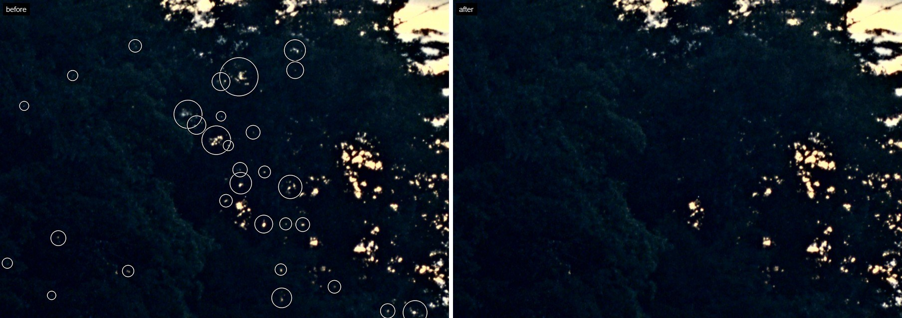
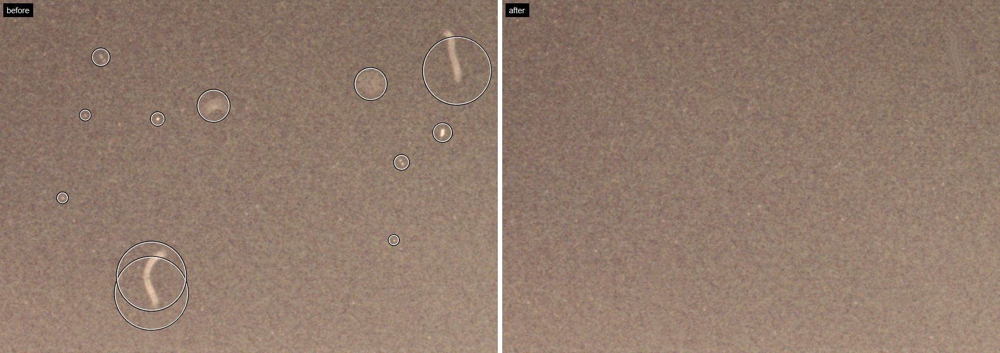
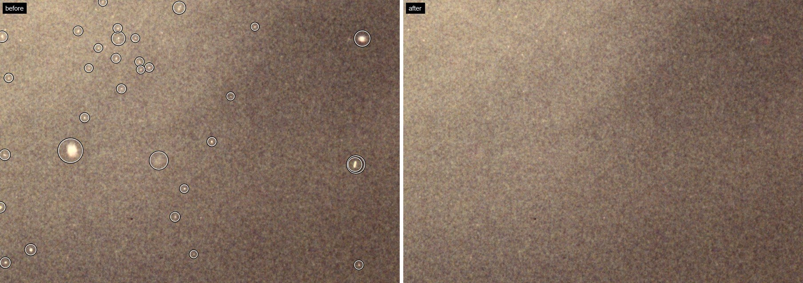
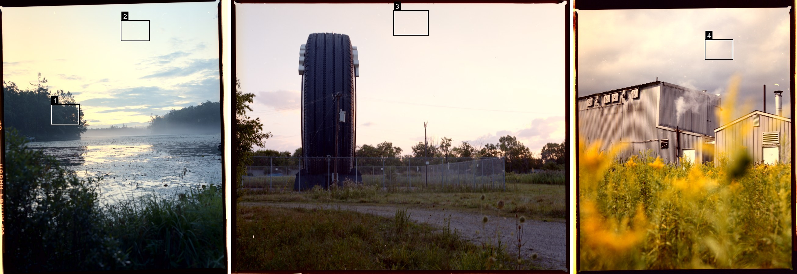

# film dust

A Photoshop plugin that removes dust, hairs and fibres from film scans.

<p>
<a href="https://github.com/magholmes/film-dust/releases/latest/download/film-dust-windows.ccx"><picture><source media="(prefers-color-scheme: dark)" srcset="docs/buttons/windows-dark.svg"></picture></a>&nbsp;
<a href="https://github.com/magholmes/film-dust/releases/latest/download/film-dust-mac.ccx"><picture><source media="(prefers-color-scheme: dark)" srcset="docs/buttons/mac-dark.svg"></picture></a>
</p>



<sub>Everything it removed is circled on the left. The sunlit leaves aren't dust, so they stay.</sub>

I shoot film and my scans always have dust on them. Spotting it out by hand was taking longer than the edit itself, so I made this.

Open a scan and hit Remove dust. Every fix goes on a new layer with a mask, so your original stays untouched. If it took out something it shouldn't have, paint black on the mask and it comes back.

## Before and after

I turned the contrast up on these so you can actually see the dust. Same edit on both sides.



Soft, out-of-focus dust in a sunset sky. The grain underneath stays.



Specks over dark trees.



Fibres.



About thirty spots in one corner of a cloudy sky.



Where the crops came from.

## What it removes

- White specks on scanned negatives and black specks on slides. It works out which one you've got.
- Hairs and fibres.
- Soft, out-of-focus dust, including the faint circles you get in skies.

It leaves catchlights, reflections, sun through leaves and other highlights alone.

## How to use it

1. Open a scan in Photoshop.
2. Go to Plugins → film dust.
3. Hit Remove dust.

A 60–70 MP scan takes about a minute on Windows.

## Install

1. Download the file for your computer.
2. Double-click it and Creative Cloud installs it. On Windows it asks for admin permission.
3. Restart Photoshop.

You need Photoshop 2024 (25.0) or newer.

If double-clicking doesn't work, you can install it with Adobe's installer from a terminal. On Windows:

```
"C:\Program Files\Common Files\Adobe\Adobe Desktop Common\RemoteComponents\UPI\UnifiedPluginInstallerAgent\UnifiedPluginInstallerAgent.exe" /install film-dust-windows.ccx
```

On a Mac:

```
"/Library/Application Support/Adobe/Adobe Desktop Common/RemoteComponents/UPI/UnifiedPluginInstallerAgent/UnifiedPluginInstallerAgent.app/Contents/MacOS/UnifiedPluginInstallerAgent" --install film-dust-mac.ccx
```

Can't give it admin rights on Windows? The Mac file works on Windows too. It's slower, but it doesn't need admin.

## Privacy

It all runs on your computer. No account, and nothing gets uploaded.

## Building it yourself

```
bash native/build.sh
node build.js
```

The engine is plain JavaScript in `engine/`. The Windows build adds a C++ version of the slowest parts in `native/`, which gives the same results, just faster. Building it needs a GCC toolchain and Adobe's UXP hybrid plugin SDK headers in `native/uxp-sdk/`. They're Adobe's, so they aren't included here. Third-party code is listed in `NOTICES.txt`.

## Licence

[MIT](LICENSE.txt)

Made by [Magnus Holmes](https://magnusholmes.com).
